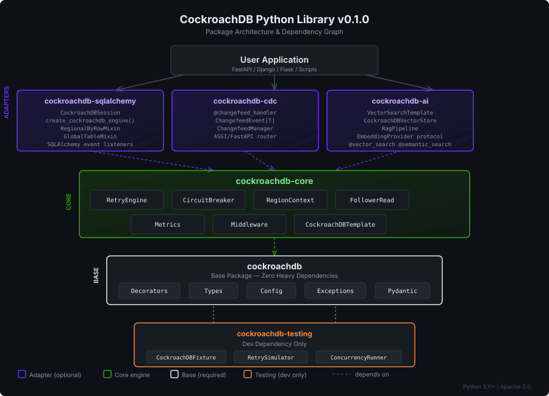
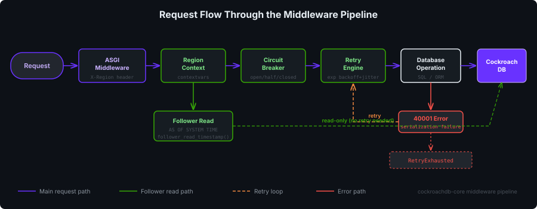

# CockroachDB Python Library

[](https://github.com/cockroachlabs/cockroachdb-python-library/actions/workflows/ci.yml)
[](https://github.com/cockroachlabs/cockroachdb-python-library/releases)
[](https://www.python.org/)
[](LICENSE)

A production-grade Python library for [CockroachDB](https://www.cockroachlabs.com/) that provides automatic transaction retry handling, multi-region support, follower reads, CDC webhook handlers, vector search, and RAG pipelines. Part of the CockroachDB language-specific library family alongside the [Java Spring Boot Starter](https://github.com/cockroachlabs/cockroachdb-java-library), [.NET Library](https://github.com/cockroachlabs/cockroachdb-dotnet-library), and [Go Library](https://github.com/cockroachlabs/cockroachdb-go-library).

## Architecture

<p align="center">
  
</p>

The library is structured as a layered monorepo of six packages with a clear dependency graph. Install only what you need.

<p align="center">
  
</p>

## Quick Install

> Packages are published to this repository's GitHub Pages index (not PyPI).
> Add `--extra-index-url https://cockroachlabs.github.io/cockroachdb-python-library/simple/`
> to each `pip install` below, or set it once in your `pip.conf`.

```bash
# Base package (decorators, types, config, exceptions)
pip install cockroachdb

# Core engine (retry, circuit breaker, regions, middleware)
pip install cockroachdb-core

# SQLAlchemy 2.0 adapter
pip install cockroachdb-sqlalchemy

# CDC changefeed webhook handlers
pip install cockroachdb-cdc

# AI / Vector search / RAG pipelines
pip install cockroachdb-ai

# Testing utilities (dev dependency)
pip install cockroachdb-testing
```

Or install everything:

```bash
pip install cockroachdb cockroachdb-core cockroachdb-sqlalchemy cockroachdb-cdc cockroachdb-ai cockroachdb-testing
```

## Usage

### 1. Basic Retry with `@crdb_retry`

The `@crdb_retry` decorator handles CockroachDB serialization errors (SQLSTATE 40001) with exponential backoff and jitter.

**Sync:**

```python
import psycopg2
from cockroachdb import crdb_retry


@crdb_retry(max_retries=5, base_delay=0.1, max_delay=5.0)
def transfer_funds(conn, from_id: int, to_id: int, amount: float) -> None:
    with conn.cursor() as cur:
        cur.execute("UPDATE accounts SET balance = balance - %s WHERE id = %s", (amount, from_id))
        cur.execute("UPDATE accounts SET balance = balance + %s WHERE id = %s", (amount, to_id))
    conn.commit()
```

**Async:**

```python
import asyncpg
from cockroachdb import crdb_retry


@crdb_retry(max_retries=5)
async def transfer_funds(pool, from_id: int, to_id: int, amount: float) -> None:
    async with pool.acquire() as conn:
        async with conn.transaction():
            await conn.execute(
                "UPDATE accounts SET balance = balance - $1 WHERE id = $2", amount, from_id
            )
            await conn.execute(
                "UPDATE accounts SET balance = balance + $1 WHERE id = $2", amount, to_id
            )
```

### 2. CockroachDBTemplate (Programmatic API)

```python
from cockroachdb.core import CockroachDBTemplate

template = CockroachDBTemplate(dsn="postgresql://root@localhost:26257/defaultdb")

# Execute with automatic retry
result = template.execute(
    "INSERT INTO users (name, email) VALUES (%s, %s) RETURNING id",
    ("Alice", "alice@example.com"),
)


# Transaction with retry
def do_transfer(conn):
    with conn.cursor() as cur:
        cur.execute("UPDATE accounts SET balance = balance - 100 WHERE id = 1")
        cur.execute("UPDATE accounts SET balance = balance + 100 WHERE id = 2")


template.transaction(do_transfer)
```

### 3. SQLAlchemy Session with Retry

```python
from sqlalchemy import Column, Integer, String
from sqlalchemy.orm import DeclarativeBase

from cockroachdb.sqlalchemy import create_cockroachdb_engine, CockroachDBSession

engine = create_cockroachdb_engine("cockroachdb://root@localhost:26257/defaultdb")


class Base(DeclarativeBase):
    pass


class User(Base):
    __tablename__ = "users"
    id = Column(Integer, primary_key=True)
    name = Column(String(100))


# Session with automatic serialization retry
with CockroachDBSession(engine) as session:
    user = User(name="Bob")
    session.add(user)
    session.commit()
```

### 4. Follower Reads

CockroachDB's [follower reads](https://www.cockroachlabs.com/docs/stable/follower-reads.html) let any replica serve reads at a slightly stale timestamp (about 4.2s old), avoiding the round-trip to the leaseholder. Mark a read with `@follower_read` and it runs `AS OF SYSTEM TIME` — always a follower read, never a silent fallback to current data:

```python
from cockroachdb import follower_read


@follower_read()
def get_dashboard_data(conn):
    """Read from the nearest follower replica — no cross-region latency."""
    with conn.cursor() as cur:
        cur.execute("SELECT * FROM analytics_summary")
        return cur.fetchall()
```

#### Choosing how far back to read

By default the read runs at `follower_read_timestamp()`. Use the keyword-only `hours_ago`, `minutes_ago` and `seconds_ago` params to read further back — they add up and compose to `AS OF SYSTEM TIME '-Ns'`:

```python
@follower_read()                                 # follower_read_timestamp()
@follower_read(seconds_ago=20)                   # '-20s'
@follower_read(minutes_ago=5)                    # '-300s'
@follower_read(hours_ago=1)                      # '-3600s'
@follower_read(hours_ago=1, minutes_ago=30)      # '-5400s' (1h30m ago)
```

When no additive part is set, the `staleness` string is used — pass a built-in like `follower_read_timestamp()` (default) or a raw interval. A time more recent than `follower_read_timestamp()` still reads historical data, but the leaseholder serves it rather than the nearest replica; a time older than the table's GC window fails in CockroachDB.

#### Context manager and SQLAlchemy

The same additive params work on the `FollowerReadContext.scoped()` context manager (and the template/SQLAlchemy-session helpers that delegate to it):

```python
from cockroachdb.core.follower_read import FollowerReadContext

with FollowerReadContext.scoped(minutes_ago=2, seconds_ago=30):  # '-150s'
    ...  # every read in this block runs AS OF SYSTEM TIME

# SQLAlchemy session helper — reads go to a follower for the callback's duration
session.follower_read(lambda s: s.query(Product).all(), seconds_ago=20)
```

The SQLAlchemy session `follower_read()` helper routes through the same mechanism and is fully functional (an earlier version raised `AttributeError` at runtime; fixed).

#### Misuse fails instead of reading current data

Staleness composition lives in one place — `build_staleness()` (exported from `cockroachdb`) — which never silently falls back to a current read. A **negative** `hours_ago`/`minutes_ago`/`seconds_ago` raises `ValueError` at call time (at decoration time for `@follower_read`, before any session opens for the context manager and SQLAlchemy helper):

```python
from cockroachdb import build_staleness

build_staleness(minutes_ago=2, seconds_ago=30)  # "'-150s'"
build_staleness()  # "follower_read_timestamp()"
build_staleness(seconds_ago=-1)  # raises ValueError
```

#### When to use follower reads

| Use case | Follower read? |
|----------|---------------|
| Product browsing, search results | Yes — slight staleness is imperceptible |
| Dashboards, aggregate metrics | Yes — a few seconds lag is fine |
| Checkout, payment | No — must see real-time inventory |
| Authentication, permissions | No — must see latest credentials |


### 5. Multi-Region with Context Manager

```python
from cockroachdb import crdb_region, regional_by_row, global_table


# Pin a function to a specific region
@crdb_region("us-east1")
def create_us_user(conn, name: str) -> None:
    with conn.cursor() as cur:
        cur.execute("INSERT INTO users (name, region) VALUES (%s, 'us-east1')", (name,))
    conn.commit()


# Mark ORM models for multi-region topology
@regional_by_row(default_region="us-east1")
class UserProfile:
    """Each row lives in a specific region."""

    ...


@global_table
class CountryList:
    """Replicated to all regions for low-latency reads."""

    ...
```

### 6. CDC Webhook Handler

```python
from cockroachdb import changefeed_handler


@changefeed_handler(table="orders", operations=["insert", "update"])
def on_order_change(event):
    """Processes CockroachDB changefeed webhook events."""
    print(f"Order {event.key}: {event.operation} -> {event.after}")
```

With FastAPI router:

```python
from fastapi import FastAPI
from cockroachdb.cdc import create_changefeed_router

app = FastAPI()
app.include_router(create_changefeed_router(), prefix="/webhooks")
```

### 7. Vector Search

```python
from cockroachdb import vector_search


@vector_search(table="documents", vector_column="embedding", metric="cosine", limit=10)
def find_similar_documents(query_vector: list[float]):
    """Find documents similar to the query vector."""
    ...
```

### 8. RAG Pipeline

```python
from cockroachdb.ai import RagPipeline, CockroachDBVectorStore

vector_store = CockroachDBVectorStore(
    dsn="postgresql://root@localhost:26257/defaultdb",
    table="documents",
    vector_column="embedding",
    dimensions=1536,
)

rag = RagPipeline(
    vector_store=vector_store,
    embedding_provider=my_embedding_provider,
    chat_client=my_chat_client,
)

answer = rag.query("How does CockroachDB handle serialization conflicts?")
```

### 9. FastAPI Integration

```python
from contextlib import asynccontextmanager
from fastapi import FastAPI, Depends

from cockroachdb.core import CockroachDBTemplate
from cockroachdb.core.middleware import CockroachDBMiddleware

template = CockroachDBTemplate(dsn="postgresql://root@localhost:26257/defaultdb")


@asynccontextmanager
async def lifespan(app: FastAPI):
    yield
    template.close()


app = FastAPI(lifespan=lifespan)

# Middleware extracts region from X-CockroachDB-Region header
app.add_middleware(CockroachDBMiddleware, config=template.config)


@app.post("/api/transfer")
async def transfer(from_id: int, to_id: int, amount: float):
    def do_transfer(conn):
        with conn.cursor() as cur:
            cur.execute(
                "UPDATE accounts SET balance = balance - %s WHERE id = %s", (amount, from_id)
            )
            cur.execute(
                "UPDATE accounts SET balance = balance + %s WHERE id = %s", (amount, to_id)
            )

    template.transaction(do_transfer)
    return {"status": "ok"}
```

### 10. CockroachDB Dialect

The library includes a full SQLAlchemy dialect registered as `cockroachdb://`:

```python
from sqlalchemy import create_engine

engine = create_engine("cockroachdb+psycopg://root@localhost:26257/defaultdb")
```

The dialect provides:
- **Type mapping** — Maps 40+ CockroachDB types (`INT2`, `INT8`, `STRING`, `BYTES`, etc.) to SQLAlchemy types
- **Column reflection** — Uses `crdb_sql_type` for accurate type detection, handles hidden columns and computed columns
- **Version parsing** — Parses CockroachDB's version string (`CockroachDB CCL v24.3.x`)
- **Savepoint restart protocol** — `SAVEPOINT cockroach_restart` for server-side transaction retries
- **Index hints** — `table@index_name` syntax via `with_hint()`

### 11. Inline Index Creation (DDL Performance)

CockroachDB processes inline indexes in a single schema-change job, vs separate jobs for each `CREATE INDEX`. This results in **~25x faster** table creation:

```python
from sqlalchemy import Column, Index, Integer, MetaData, String, Table, create_engine

engine = create_engine("cockroachdb+psycopg://root@localhost:26257/defaultdb")
metadata = MetaData()

orders = Table(
    "orders",
    metadata,
    Column("id", Integer, primary_key=True),
    Column("customer", String(100)),
    Column("region", String(50)),
    Index("idx_customer", "customer"),
    Index("idx_region_total", "region", "total"),
    # CockroachDB STORING clause for covering indexes
    Index("idx_customer_store", "customer", cockroachdb_storing=["region"]),
)

metadata.create_all(engine)  # Single schema-change job
```

Generated SQL:
```sql
CREATE TABLE orders (
    id SERIAL NOT NULL,
    customer VARCHAR(100),
    region VARCHAR(50),
    PRIMARY KEY (id),
    INDEX idx_customer (customer),
    INDEX idx_region_total (region, total),
    INDEX idx_customer_store (customer) STORING (region)
)
```

### 12. Computed Columns

CockroachDB requires computed columns to be `STORED` (virtual not supported):

```python
from sqlalchemy import Column, Computed, Integer, Table, MetaData

products = Table(
    "products",
    metadata,
    Column("id", Integer, primary_key=True),
    Column("price", Integer),
    Column("qty", Integer),
    Column("total", Integer, Computed("price * qty", persisted=True)),
)
```

Setting `persisted=False` raises `CompileError` at DDL compilation time.

### 13. Alembic Migrations

The dialect integrates with Alembic automatically. Configure `alembic.ini`:

```ini
sqlalchemy.url = cockroachdb+psycopg://root@localhost:26257/mydb
```

CockroachDB DDL is non-transactional (`transactional_ddl = False`), so each migration statement auto-commits:

```bash
alembic revision --autogenerate -m "add orders table"
alembic upgrade head
```

## Configuration

All configuration is managed through Pydantic models and can be overridden via environment variables with the `CRDB_` prefix.

```python
from cockroachdb.config import CockroachDBConfig

config = CockroachDBConfig(
    retry={"max_retries": 5, "base_delay": 0.2},
    circuit_breaker={"failure_threshold": 10, "recovery_timeout": 60.0},
    region={"default_region": "us-east1", "allowed_regions": ["us-east1", "us-west2", "eu-west1"]},
    follower_read={"enabled": True},
    metrics={"enabled": True, "prefix": "myapp_crdb"},
    ai={"default_metric": "cosine", "embedding_dimensions": 1536},
)
```

### Environment Variables

| Variable | Description | Default |
|----------|-------------|---------|
| `CRDB_RETRY__MAX_RETRIES` | Maximum retry attempts | `3` |
| `CRDB_RETRY__BASE_DELAY` | Initial backoff delay (seconds) | `0.1` |
| `CRDB_RETRY__MAX_DELAY` | Maximum backoff cap (seconds) | `5.0` |
| `CRDB_CIRCUIT_BREAKER__ENABLED` | Enable circuit breaker | `true` |
| `CRDB_CIRCUIT_BREAKER__FAILURE_THRESHOLD` | Failures before opening | `5` |
| `CRDB_CIRCUIT_BREAKER__RECOVERY_TIMEOUT` | Seconds before half-open | `30.0` |
| `CRDB_REGION__DEFAULT_REGION` | Default CockroachDB region | `None` |
| `CRDB_REGION__REGION_HEADER` | HTTP header for region extraction | `X-CockroachDB-Region` |
| `CRDB_FOLLOWER_READ__ENABLED` | Enable follower reads | `true` |
| `CRDB_METRICS__PREFIX` | Prometheus/OTEL metric prefix | `cockroachdb` |
| `CRDB_AI__EMBEDDING_DIMENSIONS` | Default embedding vector size | `1536` |

## Testing

### CockroachDBFixture (Testcontainers)

```python
import pytest
from cockroachdb.testing import CockroachDBFixture


@pytest.fixture
def crdb():
    with CockroachDBFixture() as fixture:
        fixture.execute("CREATE TABLE users (id INT PRIMARY KEY, name STRING)")
        yield fixture


def test_insert_user(crdb):
    crdb.execute("INSERT INTO users VALUES (1, 'Alice')")
    rows = crdb.fetch_all("SELECT * FROM users")
    assert len(rows) == 1
    assert rows[0]["name"] == "Alice"
```

### RetrySimulator

```python
from cockroachdb.testing import RetrySimulator


def test_retry_handles_serialization_errors():
    simulator = RetrySimulator(fail_count=3)

    @crdb_retry(max_retries=5)
    def flaky_operation():
        simulator.maybe_fail()  # Raises 40001 for first 3 calls
        return "success"

    result = flaky_operation()
    assert result == "success"
    assert simulator.attempt_count == 4
```

## Feature Parity

Comparison with sibling libraries across the CockroachDB ecosystem:

| Feature | Java (Spring) | .NET | Go | Python |
|---------|:---:|:---:|:---:|:---:|
| **Auto-retry (40001)** | `@CockroachDB` | `[CockroachDB]` | `WithRetry()` | `@crdb_retry` |
| **Transaction template** | `CockroachDBTemplate` | `CockroachDBTemplate` | `Execute()` | `CockroachDBTemplate` |
| **Circuit breaker** | Yes | Yes | Yes | Yes |
| **Multi-region context** | `ThreadLocal` | `AsyncLocal` | `context.Context` | `contextvars` |
| **Follower reads** | `@FollowerRead` | `[FollowerRead]` | Functional opt | `@follower_read` |
| **Regional-by-row** | `@RegionalByRow` | `[RegionalByRow]` | Functional opt | `@regional_by_row` |
| **Global table** | `@GlobalTable` | `[GlobalTable]` | Functional opt | `@global_table` |
| **CDC webhooks** | `@CockroachDBCDC` | `MapChangefeed` | -- | `@changefeed_handler` |
| **Vector search** | `VectorSearchTemplate` | `VectorSearchTemplate` | -- | `VectorSearchTemplate` |
| **RAG pipeline** | Spring AI | `RagChatClient` | -- | `RagPipeline` |
| **ASGI middleware** | Filter | Middleware | Middleware | `CockroachDBMiddleware` |
| **Pydantic config** | -- | -- | -- | `CockroachDBConfig` |
| **async/await** | Reactor | async/await | goroutines | `asyncio` native |

## Package Dependency Graph

```
cockroachdb-testing ─────────────────────────────────────┐
  (dev only)                                             │
                                                         ▼
cockroachdb-sqlalchemy ──┐                          cockroachdb
cockroachdb-cdc ─────────┼──► cockroachdb-core ──►   (base pkg)
cockroachdb-ai ──────────┘     RetryEngine              │
                               CircuitBreaker        Decorators
                               RegionContext         Types
                               FollowerRead          Config
                               Middleware             Exceptions
                               Metrics                Pydantic
```

## Cockroach Continuum

Optional surfaces for [Cockroach Continuum](https://www.cockroachlabs.com/docs/continuum), separate from the core retry path. Every client falls back to an in-memory simulated backend when no API key/endpoint is configured, so code runs without a Continuum organization. The HTTP clients use only the standard library and accept an injectable transport for tests.

```python
from cockroachdb.continuum import (
    CloudConfig,
    make_cloud,
    datadog_export,
    health,
    VirtualClusterManager,
    routing_conn_string,
    McpConfig,
    make_mcp,
    McpAegisClient,
    McpToolNames,
)

# --- Cloud control plane (simulated until api_key is set) ---
cloud = make_cloud(CloudConfig(enabled=True, api_key=key))
clusters = cloud.list_clusters()
cloud.configure_metric_export(cluster_id, datadog_export(dd_key, "US1"))  # typed builders
ready = health(cloud)  # bool

# --- Virtual clusters + routing ---
vm = VirtualClusterManager(conn)  # any DB-API connection (e.g. psycopg)
vm.create("analytics")
dsn = routing_conn_string(base_dsn, "analytics")  # adds -ccluster option

# --- MCP client (real 2025-06-18 wire protocol) + Aegis over MCP ---
mcp = make_mcp(McpConfig(enabled=True, endpoint="https://cockroachlabs.cloud/mcp", token=key))
tools = mcp.list_tools()
aegis = McpAegisClient(
    mcp, McpToolNames(findings="list_findings")
)  # discover names via list_tools
findings = aegis.findings()
```

MCP is a public, versioned protocol, so the client speaks the real wire format (initialize handshake, `tools/list`, `tools/call`, SSE + session handling). The Aegis REST API is not yet public, so Aegis is reached read-only **over MCP** with caller-supplied tool names rather than an invented wire protocol.

Also in the `continuum` package: a standalone **Aegis** client (findings/recommendations + app "exhaust"), **Plenum** storage insights, and **vCluster** workload tagging.

```python
from cockroachdb.continuum import (
    AegisConfig,
    make_aegis,
    AegisExhaust,
    storage_summary,
    vcluster,
    Priority,
)

# Aegis — simulated until an endpoint is set:
aegis = make_aegis(AegisConfig(enabled=True))
aegis.findings()
AegisExhaust(aegis).record_retry("PayrollService.run", attempt=2)

# Plenum — read-only, customer-safe storage insights:
tables = storage_summary(conn)

# vCluster — workload tagging / QoS:
with vcluster("analytics", Priority.LOW):
    run_report()
```

## Contributing

1. Fork the repository
2. Create a feature branch: `git checkout -b feature/my-feature`
3. Set up the dev environment (see [SETUP.md](SETUP.md))
4. Make changes and add tests
5. Run checks: `uv run ruff check . && uv run mypy . && uv run pytest`
6. Submit a pull request

Please follow existing code style (enforced by ruff) and ensure all tests pass.

## License

This project is licensed under the [Apache License 2.0](https://www.apache.org/licenses/LICENSE-2.0).

```
Copyright 2024 CockroachDB Authors

Licensed under the Apache License, Version 2.0 (the "License");
you may not use this file except in compliance with the License.
You may obtain a copy of the License at

    http://www.apache.org/licenses/LICENSE-2.0
```
